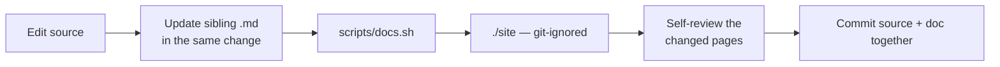

# AGENTS.md



## Project Overview

mirror-clone is a cross-platform command-line tool that clones GitHub repositories (and their submodules) through a local cache of mirrors, so repeated clones only transfer the objects that are actually new. It is written in Go (module `github.com/fordaj/MirrorClone`, Go 1.23, no third-party dependencies — the standard library only) and ships as a single, dependency-free binary for Linux, macOS and Windows (x86_64 and arm64).

The binary clones through `~/.mirror-clones` by default, refreshes the mirror on every use (`git fetch --prune`), resolves relative submodule URLs against the superproject, and can install, update and uninstall itself. The release archives are built with `scripts/build.sh`/`scripts/release.sh` and published to the GitHub releases of `fordaj/MirrorClone`.

## Core Principles

- **Clone through the mirror cache.** Every clone and every submodule clone goes through the mirror; the working copy borrows the mirror's objects (`--reference … --dissociate`) and stays valid when the cache is removed.
- **Never lose work.** A failed update, a failed copy or a diverged branch must not destroy the user's installation or the local clone: backups and `replaceFile` restore the previous state, and fast-forwards are `--ff-only` with a warning, not a reset.
- **Unattended operation.** The tool must work from scripts and CI: no interactive credential prompts (`GIT_TERMINAL_PROMPT=0`), no `PATH` edits, no config changes — it prints the line the user has to add and stops there.
- **Source, don't reimplement.** Shell logic flows through `scripts/entry.sh` (environment cascade + `log()`); versions come from versioner; binaries are stamped with `-ldflags`, never with a hand-edited constant.
- **Documentation lives next to the code.** Every documented file has a sibling `.md` page; see "Documentation files (barnacle)" below.
- **Mermaid-forward.** Every page opens with a Mermaid diagram right under its `#` heading — the reader gets the map before the territory. Guidance, never a hard rule: barnacle only prints a non-fatal stderr note listing pages without one. See "Documentation files (barnacle)" below.

## Build and Test

The README is the source of truth for the commands; the real ones are:

```bash
./scripts/build.sh                # release build of the host platform (dist/<platform>/)
./scripts/build.sh --all          # every platform
./scripts/test.sh                 # gofmt, go vet, go build, go test, smoke test, shellcheck, formatting
./scripts/test.sh --coverage      # also writes coverage.out
./scripts/format.sh               # format the sources (formattington via uv)
./scripts/format.sh --check       # verify only
./scripts/version.sh      # print the version computed by versioner
./scripts/docs.sh           # regenerate the documentation site (./site/)
```

Requirements: the Go toolchain (1.23+), `git`, `uv` for the formatters (`uv sync` installs the locked versions), `gh` for releases and tool refreshes. Tests live next to the code (`*_test.go`, standard `testing` package) and use no network access. Do not invent commands for tools that are not configured.

Before considering a change complete, run `./scripts/test.sh`. If you touch any documented file, also run `./scripts/docs.sh` and keep the sibling pages current (see below).

## Repository Layout

```text
<root>/                the Go module (package main) — one .go per concern:
                       cli.go, mirror.go, git.go, url.go, version.go, logger.go,
                       install.go, update.go, release.go, main.go, plus the
                       per-platform executable_unix.go / executable_windows.go
scripts/           task scripts — format.sh, build.sh, release.sh, run.sh, test.sh,
                       docs.sh, version.sh — plus entry.sh, env.sh (the cascade)
                       and the hidden .common.env + .<platform>.env. See scripts/README.md
tools/                 pinned helper bundles (versioner, logamuffin, runner-spawner,
                       barnacle, 7zip) — see tools/README.md
.formattington.json    formatter configuration
.versioner.json        versioner configuration
pyproject.toml/uv.lock formattington environment (uv)
```

The Go sources are at the root on purpose; `dist/` holds build output and is git-ignored. `site/` is the generated documentation and is git-ignored as well.

## Documentation files (barnacle)

The repository's documentation is a set of Markdown (`.md`) and Mermaid (`.mmd`) source files rendered into a static site by the pinned [barnacle](https://github.com/fordaj/barnacle) binary (`tools/barnacle/`, wired into the environment cascade as `BARNACLE_BIN`). Generate the site with `scripts/docs.sh`; the output (`./site/`) is git-ignored and never committed. `tools/` is excluded from the generated site via `.barnacle.json` (`{"title": "mirror-clone", "exclude": ["tools"]}`), so the pinned bundles' pages exist for the repository, not for the site.

Layout — documentation lives next to the code it describes:

- One sibling `.md` per root Go file, retaining the Go suffix (`cli.go` → [cli.go.md](cli.go.md), `main.go` → [main.go.md](main.go.md), `release.go` → [release.go.md](release.go.md), `mirror.go` → [mirror.go.md](mirror.go.md)). One deliberate exception: one `executable.md` page covers both `executable_unix.go` and `executable_windows.go` (the build-tag pair shares one contract).
- One sibling `.md` per script in `scripts/`, retaining the shell suffix (`scripts/build.sh` → [scripts/build.sh.md](scripts/build.sh.md), `scripts/format.sh` → [scripts/format.sh.md](scripts/format.sh.md), `scripts/release.sh` → [scripts/release.sh.md](scripts/release.sh.md), `scripts/run.sh` → [scripts/run.sh.md](scripts/run.sh.md), `scripts/test.sh` → [scripts/test.sh.md](scripts/test.sh.md), `scripts/docs.sh` → [scripts/docs.sh.md](scripts/docs.sh.md), `scripts/entry.sh` → [scripts/entry.sh.md](scripts/entry.sh.md), `scripts/env.sh` → [scripts/env.sh.md](scripts/env.sh.md), `scripts/version.sh` → [scripts/version.sh.md](scripts/version.sh.md)), plus `scripts/README.md` as the hub.
- One sibling `.md` per bundle in `tools/` (`tools/<name>/update.sh` → `tools/<name>/update.sh.md`), plus `tools/README.md` as the hub. The 7zip bundle is documented by `tools/7zip/update.sh.md` like the others.
- `README.md` stays the project front page; do not restructure it.

Naming rules:

- **Retain the documented file's suffix.** A documentation file for `main.go` is `main.go.md`; for `scripts/docs.sh` it is `scripts/docs.sh.md`; for `tools/barnacle/update.sh` it is `tools/barnacle/update.sh.md`. This exists so files that share a base name stay individually documentable.
- Free-standing diagrams that do not document one specific file (for example `architecture.mmd`) may keep plain names; hub pages (`README.md` in each documented directory) keep their plain names.
- A `foo.md` and a `foo.mmd` may not coexist for the same stem — barnacle fails the whole site rather than overwriting. Retained suffixes make the colliding pair explicit (`main.go.md` and `main.go.mmd` both generate `main.go.html`).

Rules for keeping these files current:

- When you add, rename, remove, or repurpose a documented file — a Go file, a script, or a bundle — update its sibling `.md` **in the same change**. A new file without its page is incomplete work; a stale page is worse than none.
- **Every page opens with a Mermaid diagram** under its `#` heading — the map of the territory the page covers, in the diagram type that fits best. Guidance, never a hard rule: barnacle only prints a non-fatal stderr note listing pages without one (`.barnacle.json` key `warnMissingMermaid`, default `true`). If you add or rewrite a page, open it with a diagram — and prefer making that diagram navigate the site.
- **Make diagrams clickable.** `click Node href "target.md"` directives make flowchart nodes link to the pages they describe (rewritten to `.html` like any other doc link); inline anchors in edge labels make transitions navigable (`Idle --> Waiting : <a href="target.md">send(cmd)</a>`) — no JS, no directives. Targets are relative to the page, exactly like Markdown links.
- Source every fact: the `.go`/`.sh`/`.bash` file itself, this file (AGENTS.md), and README.md are the accepted sources. Never invent flags, exit codes, extensions, or bundle-platform matrices.
- Use plain relative links (`cli.go.md`, `../../README.md`) with the linking file's `.md` path — barnacle rewrites them (and `.md` targets inside `click` directives and label anchors) to `.html`. Do not link to files barnacle does not render (binaries, `.sh`, `LICENSE`); link the related `.md` page (for external references, a full `https://` URL is fine).
- Rendered pages must not hyperlink into `tools/` — `.barnacle.json` excludes those pages from the site, so a link there would 404. Refer to them as code (for example `tools/barnacle/update.sh.md`); unrendered `tools/` pages may link freely.
- Hub pages (`README.md` in each documented directory) list their siblings; adding a page means linking it from the hub (and the hub's diagram) too, in the same order as the rest of the directory's list.
- Barnacle skips hidden files by default, so the `.common.env` and `.<platform>.env` cascade is documented inside [scripts/env.sh.md](scripts/env.sh.md) — keep it accurate there instead of adding hidden doc files.
- Regenerate and self-review the site before publishing: `./scripts/docs.sh`; the generator output must remain free of broken local links, and the stderr note must list zero pages without a diagram.

Definition of Done addition: a change that touches any documented file updates (or creates) its sibling page in the same commit — including the diagram at the top.

## Definition of Done

A change is complete when it:

- Implements the requested behavior.
- Preserves the established CLI contract (commands, flags, exit codes) unless intentionally changed — `cli.go` and the README option table move together.
- Handles errors without losing the user's work (see the "Never lose work" principle).
- Remains compatible with the supported platforms (Linux, macOS, Windows × x86_64, arm64) — platform differences go in the `executable_*.go` pair or the environment cascade, not in ad-hoc conditionals.
- Includes or updates tests where appropriate (`go test ./...` via `./scripts/test.sh`).
- Updates relevant documentation — including the sibling `.md` pages above for every Go, bash, or tools/ file touched, and the hub listing when a page is added or removed.
