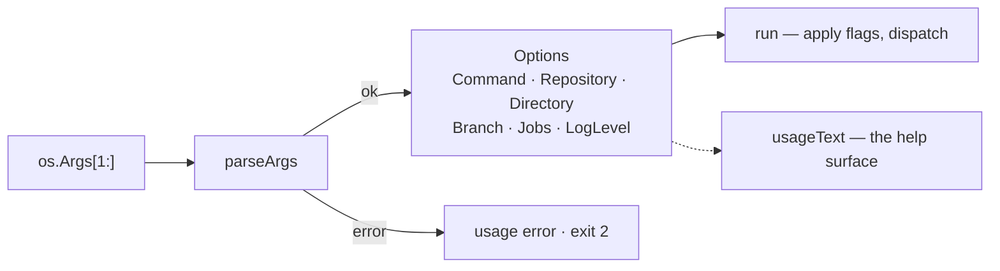

# Command line parsing (`cli.go`)

`cli.go` defines the command line surface of the tool: the `Options` struct, the self management `Command` constants, the `usageText` help text, and `parseArgs`.

## Commands

`Command` is a string type; the empty value is the clone (default) command. `install`, `uninstall` and `update` are recognized as the first positional argument by `commandByName` and take no further arguments — extra arguments are a usage error.

## Options

`Options` holds `Command`, `Repository`, `Directory`, `Branch`, `MirrorCacheDir`, `Jobs`, `LogLevel` (default `LevelInfo`), `ShowVersion` and `ShowHelp`. `defaultCacheDirName` is `.mirror-clones`.

## Parsing rules

`parseArgs` handles flags before or after the positional arguments; `--` ends flag parsing. Long flags accept `--flag value` and `--flag=value`; short flags (`-b`, `-j`, `-q`, `-v`, `-h`) accept a separate value or a joined/`=`-prefixed one. Missing values, unknown flags, `--jobs` that is not an integer ≥ 1, and more than two positional arguments are all errors. With no positional arguments, `--help`/`--version` are fine, anything else is `no repository given`.

The value and validation of the value-taking flags are shared between the long and the short forms: `flagValue` reads the attached value (`--flag=value`/`-fvalue`) or advances to the next argument (error `flag <flag> requires a value` when there is none), and `parseJobs` validates the `--jobs`/`-j` value (an integer ≥ 1).

The usage text (`usageText`) documents the same surface: `-b/--branch`, `--mirror-cache-dir`, `-j/--jobs` (default: number of CPUs), `--log-level` (error, warn, info, debug; default info), `-q/--quiet` (same as `--log-level error`), `-v/--version`, `-h/--help`.

Flag semantics are applied in [main.go](main.go.md); `--log-level` values are converted with `ParseLevel` ([logger.go.md](logger.go.md)).

## Related pages

- [main.go.md](main.go.md) — where the parsed options are consumed
- [logger.go.md](logger.go.md) — `ParseLevel` and the levels
- [README.md](README.md) — the user-facing option table
