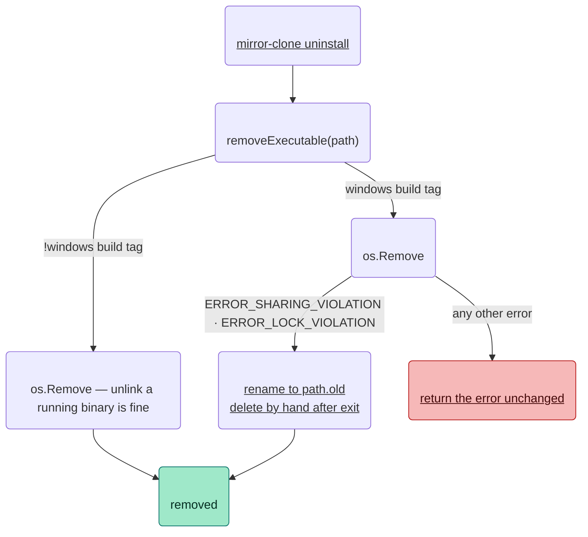

# Removing the executable (`executable_unix.go` + `executable_windows.go`)

`removeExecutable(path)` deletes the installed executable. It is the one piece of the self-management flow that differs between platforms, so it lives in two files selected by build tag.

## `executable_unix.go` (`//go:build !windows`)

Just `os.Remove(path)`. On Unix systems a running executable can be removed — the file is unlinked and stays usable until the process ends.

## `executable_windows.go` (`//go:build windows`)

Windows locks a running executable, so `os.Remove` can fail with `ERROR_SHARING_VIOLATION` (32) or `ERROR_LOCK_VIOLATION` (33) — matched by `isFileLocked` via `errors.As` on `syscall.Errno`. In that case the file is renamed to `path + backupSuffix` (the shared `backupSuffix` constant from [install.go.md](install.go.md), `.old`); a leftover `.old` is removed first, and the function returns an error message telling the user the file was moved aside and has to be removed by hand once the program is closed. Any other error is returned unchanged.

The split exists for the uninstall path; the update path handles the same locking case in `replaceFile` ([install.go.md](install.go.md)). Uninstall also removes a leftover `.old` file.

One page covers both files because the contract (`removeExecutable(path string) error`) is identical and the Windows file is the only difference; see AGENTS.md.

## Related pages

- [install.go.md](install.go.md) — the uninstall flow that calls this
- [update.go.md](update.go.md) — the update flow with its own locking workaround
