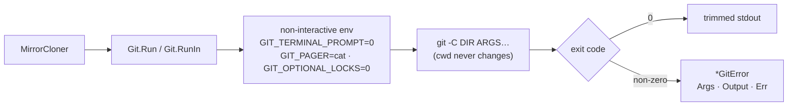

# The git runner (`git.go`)

`git.go` wraps every `git` invocation of the tool. Nothing in the repository shells out to git directly; everything goes through `Git`.

## `GitError`

A failed git command is reported as a `*GitError` carrying `Args`, the combined `Output` (stderr then stdout) and the underlying `Err`. `Error()` includes the trimmed git output so the caller sees the real reason (authentication, bad ref, …) instead of a bare exit status; `Unwrap()` exposes the exec error.

## `Git`

`NewGit(log)` returns a runner with `bin: "git"` that logs every command at debug level. `Run(ctx, dir, args...)` executes `git -C <dir> <args...>` (the working directory of the process is never changed, so concurrent clones cannot interfere), captures stdout and stderr separately and returns the trimmed stdout. The environment is forced to non-interactive operation: `GIT_TERMINAL_PROMPT=0`, `GIT_PAGER=cat`, `GIT_OPTIONAL_LOCKS=0` — the tool is meant to run unattended.

`RunIn(ctx, dir, args...)` is a boolean probe for commands whose output is irrelevant (used by `cloneFromMirror` in [mirror.go.md](mirror.go.md)).

## Used by

[mirror.go.md](mirror.go.md) for every clone/fetch/checkout/config/ls-files operation.

## Related pages

- [mirror.go.md](mirror.go.md)
- [main.go.md](main.go.md)
