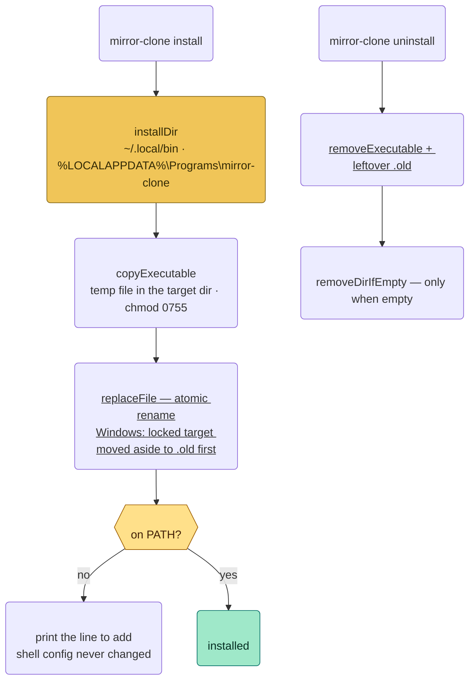

# Self install and uninstall (`install.go`)

`install.go` implements `mirror-clone install` and `mirror-clone uninstall`: copying the running executable into a per-user directory and removing it again.

## Install location

`installDir(goos, home, localAppData)` maps the platform to the install directory — `~/.local/bin` on Linux and macOS, `%LOCALAPPDATA%\Programs\mirror-clone` on Windows — and errors on other platforms. `defaultInstallDir` resolves it for the running machine; `executableName` appends `.exe` on Windows; `installPath` joins the two.

## Install flow

`runInstall` resolves the directory, finds the running executable with `os.Executable()`, and calls `install(source, dir, name)`, which creates the directory (`0755`) and copies through `copyExecutable`: write to a temporary file in the target directory first, `chmod 0755`, then `replaceFile` into place atomically — a failed copy never leaves a broken executable. `replaceFile` renames in one step; on Windows a locked target is moved aside to `target.old` (or `target.<pid>.old`) first and restored if the replacement fails. The `.old` suffix is the shared `backupSuffix` constant used by `uninstall` and by the Windows path ([executable.md](executable.md)). After installing, the command warns when the directory is not on `PATH` and prints the line to add — the shell configuration is never changed (`pathInstructions`).

## Uninstall flow

`runUninstall` removes the installed executable (`uninstall`, which also removes a leftover `.old` from an earlier update) and then removes the directory **only when it is empty** (`removeDirIfEmpty`). A missing executable is not an error; the configuration and the mirror cache are never touched.

`pathContains` reports whether `dir` is on the `PATH` (case-insensitive on Windows).

`removeExecutable` lives in [executable.md](executable.md) (split per platform).

## Related pages

- [executable.md](executable.md) — platform-specific removal of the running binary
- [update.go.md](update.go.md) — the self update that shares `replaceFile`/`installPath`
- [main.go.md](main.go.md) — command dispatch
- [README.md](README.md) — the self-management section
