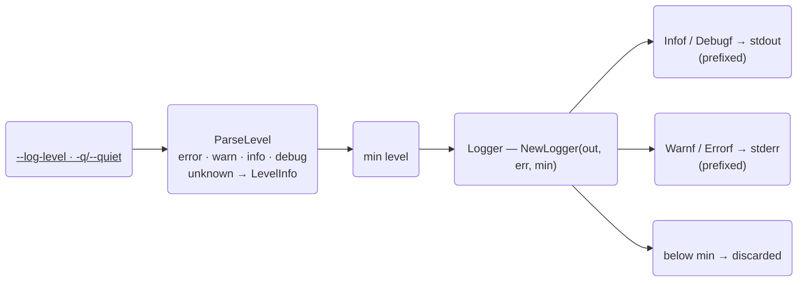

# Logging (`logger.go`)

`logger.go` defines the severity levels and the small `Logger` the whole tool uses. It is the Go-side counterpart of the shell `log()` in [scripts/entry.sh.md](scripts/entry.sh.md).

## Levels

`Level` is an `int`: `LevelError` (0), `LevelWarn` (1), `LevelInfo` (2), `LevelDebug` (3). `ParseLevel` maps `error`, `warn`/`warning`, `info`, `debug`/`trace` (case-insensitive, trimmed) and falls back to `LevelInfo` for unknown names, so a typo never silences the tool.

## The logger

`NewLogger(out, err, min)` writes informational output to `out` and warnings/errors to `err`, so stdout stays usable for piping. `DefaultLogger(min)` uses the process streams. Messages below `min` are discarded (`if l == nil || level > l.min { return }`).

- `Infof` — stdout, prefixed `mirror-clone:`
- `Debugf` — stdout, prefixed `debug:`
- `Warnf` — stderr, prefixed `warning:`
- `Errorf` — stderr, prefixed `error:`

`--log-level`, `-q`/`--quiet` and `--verbose`-style flags feed `DefaultLogger` via [cli.go.md](cli.go.md) and [main.go.md](main.go.md).

## Related pages

- [cli.go.md](cli.go.md) — where `--log-level` is parsed
- [main.go.md](main.go.md) — where the logger is constructed
- [scripts/entry.sh.md](scripts/entry.sh.md) — the shell-side `log()`
