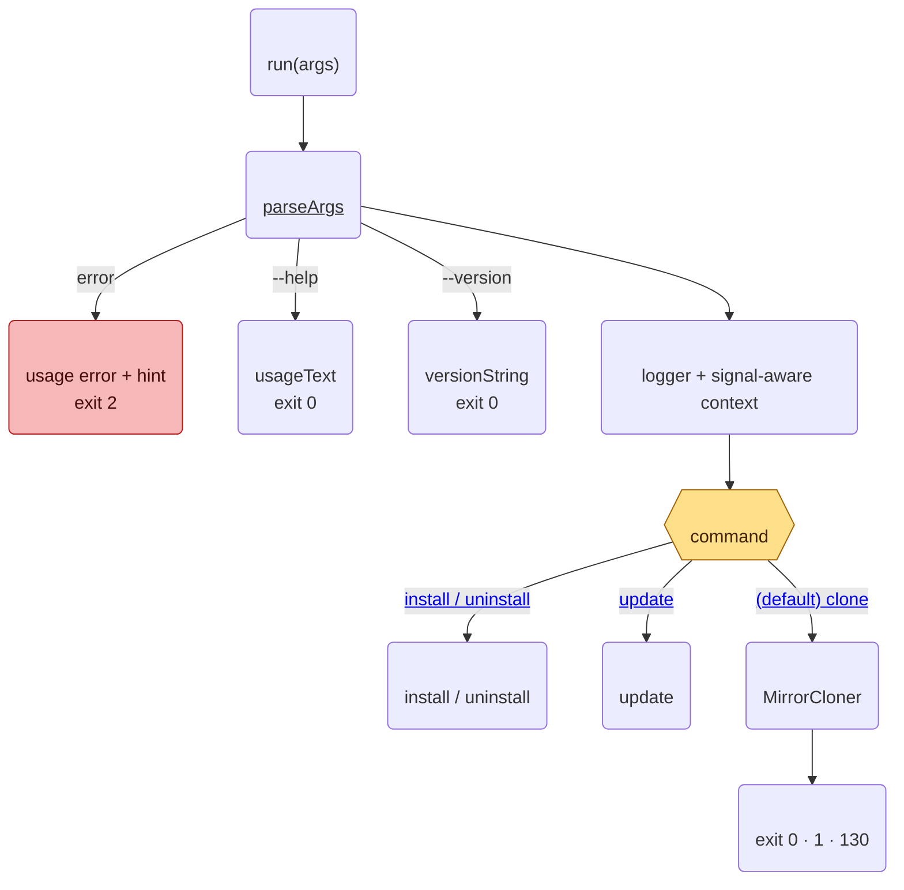

# Entry point (`main.go`)

`main.go` is the program entry point. It keeps `main()` trivial and puts the whole program logic in `run(args []string) int`, which returns the process exit code; `main` only does `os.Exit(run(os.Args[1:]))`.

## What `run` does

1. Parses the arguments with `parseArgs` ([cli.go.md](cli.go.md)). A parse error prints `mirror-clone: <err>` plus a hint to `--help` and returns exit code `2`.
2. `--help` prints `usageText` (with the default cache dir) and returns `0`; `--version` prints `mirror-clone <version>` and returns `0`.
3. Builds the logger ([logger.go.md](logger.go.md)) and a signal-aware context (`os.Interrupt`, `SIGTERM`).
4. Dispatches the self management commands `install`, `uninstall`, `update` ([install.go.md](install.go.md), [update.go.md](update.go.md)).
5. Otherwise clones: the cache dir comes from `--mirror-cache-dir`, then `MIRROR_CLONE_MIRROR_CACHE_DIR`, then `~/.mirror-clones` (see `defaultCacheDir`); the repository name is derived with `repoNameFromURL` ([url.go.md](url.go.md)); the destination defaults to the repository name inside the current directory.

The clone itself is done by `MirrorCloner` ([mirror.go.md](mirror.go.md)) built on `Git` ([git.go.md](git.go.md)). `--jobs` defaults to `runtime.NumCPU()`, capped at `maxDefaultJobs` (`8`).

## Exit codes

`2` for argument errors, `1` for runtime failures (the reason is logged), `exitInterrupted` (`130`, i.e. `128+2`) when the context was cancelled (Ctrl-C / SIGTERM, logged as `interrupted`), `0` on success and for `--help`/`--version`.

## Related pages

- [cli.go.md](cli.go.md) — argument parsing and the usage text
- [mirror.go.md](mirror.go.md) — the clone through the mirror cache
- [logger.go.md](logger.go.md) · [url.go.md](url.go.md) · [version.go.md](version.go.md)
- [install.go.md](install.go.md) · [update.go.md](update.go.md) · [scripts/release.sh.md](scripts/release.sh.md)
