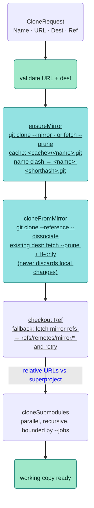

# The mirror cloner (`mirror.go`)

`mirror.go` implements the core of the tool: cloning through a local mirror cache, including recursive submodule cloning.

## Types

`CloneRequest` (`Name`, `URL`, `Dest`, `Ref`) describes one clone operation. `Submodule` (`Name`, `Path`, `URL`, `SHA`) is one `.gitmodules` entry. `MirrorCloner` holds the `Git` runner, the `Logger`, the cache directory and a `workers` channel used as a semaphore to limit parallel submodule clones (`NewMirrorCloner` clamps `jobs` to ≥ 1).

## Clone flow

`Clone` validates the URL and destination, creates the destination (with mode `0755`; parents are created as well), then:

1. `ensureMirror` — returns the path of the mirror, creating or refreshing it. The cache entry is `<cache>/<name>.git`; when that exists but points at a different URL, a disambiguated `<name>-<shorthash>.git` is used instead, so two repositories sharing a name cannot steal each other's cache. A mirror whose `origin` cannot be read is removed and re-created; an existing usable mirror is refreshed with `git fetch --prune`. New mirrors are made with `git clone --mirror`.
2. `cloneFromMirror` — clones with `--reference <mirror> --dissociate <url> <dest>`, so objects are not downloaded twice and the clone keeps working when the cache is removed. A non-empty `dest` is handled by `updateExistingClone`: the existing clone must be a git repository of the same origin, then `git fetch --prune` plus `fastForward` (a `--ff-only` merge to `origin/HEAD`, or `origin/<branch>`; local changes are never discarded, a failure only logs a warning). A non-git, non-empty destination is an error.
3. `checkout` — when `Ref` is set, checks it out; if that fails, fetches the mirror's refs into `refs/remotes/mirror/*` and retries, so commits not reachable from any remote branch still resolve.
4. `cloneSubmodules` — reads `.gitmodules` via `git config --file .gitmodules --get-regexp` (parsed by `parseGitmodules`/`splitGitmodulesLine`; entries of one repository are collected as `submoduleConfig` records in git's order) and the recorded gitlink SHAs via `git ls-files --stage` (mode `160000`, the `gitlinkMode` constant), then clones each submodule recursively through the same cache, in parallel (bounded by `jobs`), with relative URLs resolved against the superproject URL ([url.go.md](url.go.md)). Submodule errors are collected with `errors.Join`.

`isDir` and `isEmptyDir` are small helpers used by the flow (the existing-clone check probes with `m.git.RunIn(ctx, dest, "rev-parse", "--git-dir")` directly).

## Related pages

- [main.go.md](main.go.md) — how the cloner is wired up
- [git.go.md](git.go.md) — the subprocess runner it uses
- [url.go.md](url.go.md) — URL derivation and relative submodule resolution
- [logger.go.md](logger.go.md)
