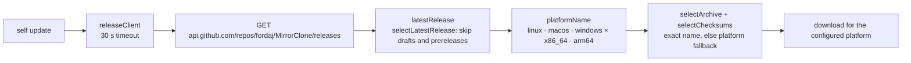

# The GitHub releases client (`release.go`)

`release.go` is the small client the self update uses to find the latest stable release of [fordaj/MirrorClone](https://github.com/fordaj/MirrorClone) on the GitHub API and to pick the archive to install. `scripts/release.sh` publishes the releases this client reads; see [scripts/release.sh.md](scripts/release.sh.md).

## The client

`newReleaseClient` targets `https://api.github.com/repos/fordaj/MirrorClone/releases` (constant `releasesURL`) with a `releaseTimeout` (30-second) timeout. `latestRelease` lists all releases and `selectLatestRelease` picks the newest that is neither draft nor pre-release, comparing tags with `compareVersions` ([version.go.md](version.go.md)). Both the release feed and the asset downloads in [update.go.md](update.go.md) go through the shared `httpGet` helper: it builds the `GET` request with the `User-Agent` header (and an optional `Accept`), logs the request at debug level, returns the open response, and turns a non-200 status into an error (`unexpected status <status>`; the body is closed first).

## Archive selection

`platformName(goos, goarch)` maps the build platform to the archive platform — `linux`/`macos`/`windows` × `x86_64`/`arm64` (`amd64` → `x86_64`), empty otherwise. `releaseAssetName(version, platform)` builds `mirror-clone_<version>_<platform>.zip`. `selectArchive` prefers the exact archive name for the version and falls back to any `mirror-clone_*_<platform>.zip` so a release that names its assets differently can still be installed. `selectChecksums` finds `checksums.txt` (exact match, or any asset whose name ends with it). Both are thin wrappers over the shared `selectAsset` helper, which implements the two-pass lookup (exact name, then a caller-supplied predicate).

## Related pages

- [update.go.md](update.go.md) — the consumer of the release feed
- [version.go.md](version.go.md) — `compareVersions` and `releaseVersion`
- [scripts/release.sh.md](scripts/release.sh.md) — the pipeline that publishes the release
- [README.md](README.md) — the releasing section
