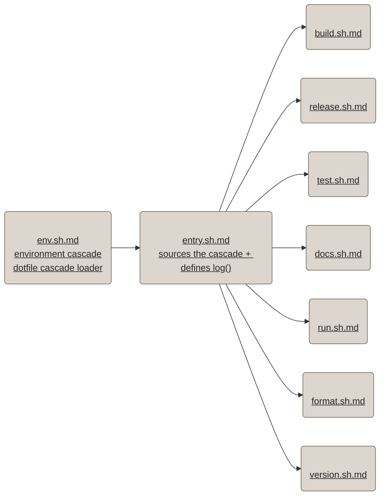

# Repository script tooling (`scripts/`)

The `scripts/` directory carries the repository's build/release/docs tooling: an environment cascade the other scripts source, plus one entry point per task. Everything here is bash; nothing requires a global install beyond what each script documents.

Vernacular used in the headers (`log INFO`, `$REPO_ROOT_DIR`, `VERSIONER_BIN`): read [entry.sh.md](entry.sh.md) first, then [env.sh.md](env.sh.md).

## The cascade (why the dotfiles exist)

- `scripts/entry.sh` — sources `scripts/env.sh` and defines `log()` (logamuffin, with a printf fallback). Sourced by everything else. See [entry.sh.md](entry.sh.md).
- `scripts/env.sh` — locates and sources the cascade below, resolves the newest bundled tool versions, anchors the repository-relative `*_BIN` tool paths to absolute paths, and falls back to `PATH` binaries when a bundled one is missing. See [env.sh.md](env.sh.md).
- `scripts/.common.env`, `scripts/.<os>-<arch>.env` — the cascade proper. Hidden files, so barnacle does not render them as pages; [env.sh.md](env.sh.md) is their documentation. `.common.env` holds the platform-independent settings (`TOOLS_DIR=tools`, the `fordaj/*` upstream repos, the pinned `*_VERSION_DIR`s, and the 7zip bundle); each platform file sets `PROJECT_PLATFORM` and the `*_BIN` paths for its `<os>-<arch>`.

## Task scripts

- [version.sh](version.sh.md) — print the repository version computed by versioner (`--format text|shell|json`).
- [docs.sh](docs.sh.md) — generate the documentation site you are reading, with the bundled barnacle.
- [build.sh](build.sh.md) — cross compile the binary for the supported platforms.
- [release.sh](release.sh.md) — version, cross compile, package, tag, and publish the GitHub release.
- [test.sh](test.sh.md) — run every check of the project.
- [run.sh](run.sh.md) — run the binary that was built for this machine.
- [format.sh](format.sh.md) — format the sources with formattington.

## Related pages

- `tools/README.md` — the pinned helper binaries
- [README.md](../README.md)
- [AGENTS.md](../AGENTS.md)
