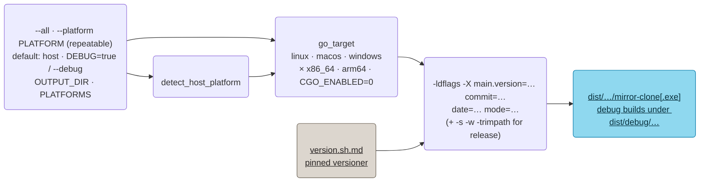

# Cross compilation (`scripts/build.sh`)



`scripts/build.sh` cross compiles the mirror-clone binary for the supported platforms. Release builds are the default (stripped, optimized, version stamped); debug builds keep the compiler's symbols and debug information.

## Usage

```bash
./scripts/build.sh                        # release build for the host platform
./scripts/build.sh --debug                # debug build for the host platform
./scripts/build.sh --all                  # release build for every platform
./scripts/build.sh --platform linux-arm64 # one platform (repeatable)
```

Options: `--debug`/`--release`, `--all`, `--platform PLATFORM` (repeatable), `--output DIR` (default `dist`), `--clean`, `--help`. Environment: `DEBUG=true` (same as `--debug`), `BUILD_MODE` (`release` or `debug`), `PLATFORMS` (space separated), `OUTPUT_DIR`. Output layout: `<output>/<platform>/mirror-clone[.exe]`, debug builds under `<output>/debug/<platform>/`.

The six supported platforms are `linux-x86_64`, `linux-arm64`, `macos-x86_64`, `macos-arm64`, `windows-x86_64`, `windows-arm64` (`go_target` maps them to `GOOS`/`GOARCH`/extension; `detect_host_platform` resolves the host). The list itself is the shared `SUPPORTED_PLATFORMS` from [entry.sh.md](entry.sh.md), used by [release.sh.md](release.sh.md) as well.

## Version stamping

When the bundled `tools/versioner/update.sh.md` is available, the version comes from [scripts/version.sh](version.sh.md); otherwise the build warns and stamps `dev`. The commit and the build date come from git (`rev-parse --short HEAD`, `show -s --format=%cI`). Everything is stamped with `-ldflags "-X main.version=... -X main.commit=... -X main.date=... -X main.mode=..."` (see [version.sh.md](../version.go.md)); release mode adds `-s -w` and `-trimpath`, debug mode uses `-gcflags "all=-N -l"`. `CGO_ENABLED=0` for every build.

Sources [scripts/entry.sh.md](entry.sh.md) for the environment cascade, `log()`, and the shared `die`/`need_cmd`/`SUPPORTED_PLATFORMS`. Requires `go` and `git` on `PATH`.

## Related pages

- [version.sh.md](../version.go.md) — the ldflags variables and `versionString`
- [scripts/release.sh.md](release.sh.md) — the release pipeline that calls this script
- [scripts/run.sh.md](run.sh.md) — running what this builds
- [scripts/test.sh.md](test.sh.md) — the checks the sources must pass
