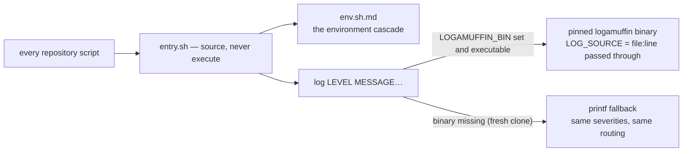

# The script entry point (`scripts/entry.sh`)



Every repository script sources `scripts/entry.sh` instead of the individual cascade files, because it does two jobs at once:

1. **It loads the environment** — it sources [env.sh.md](env.sh.md), which sources the hidden cascade (`.common.env` plus the platform file).
2. **It defines `log()`** — the shared logging function used by the scripts and by the `tools/` update scripts.

## `log()` semantics

`log LEVEL MESSAGE...` forwards to the pinned `tools/logamuffin/update.sh.md` binary referenced by `LOGAMUFFIN_BIN`. The caller context is passed through in `LOG_SOURCE` (`file[:function]:line`), and logamuffin's own exit code (`0`, or `2` for usage/config errors) is preserved even under `set -e`.

When the binary is missing (a fresh clone before the tools are populated), `log()` falls back to a `printf` implementation with the same call shape: word-to-severity mapping (`TRACE`…`ALWAYS` → numeric thresholds, via the shared `level_number` helper), `LOG_LEVEL`/`LOGAMUFFIN_LEVEL` filtering, and stream routing (ERROR and above to stderr, anything else to stdout). With no arguments it prints a usage line and returns `2`. The fallback exists so the scripts work on a brand-new checkout without network access.

`entry.sh` also defines the shared helpers the sibling scripts source:

- `SUPPORTED_PLATFORMS` — the list of the platforms the project builds and releases (`linux-x86_64`, `linux-arm64`, `macos-x86_64`, `macos-arm64`, `windows-x86_64`, `windows-arm64`). Shared by [build.sh.md](build.sh.md) and [release.sh.md](release.sh.md).
- `die` — print the message as an error and exit with `1`.
- `need_cmd` — fail unless the given command is available.
- `level_number` — convert a level name or number to its numeric severity (numbers pass through, unknown names map to `20`).

## Usage

```bash
#!/usr/bin/env bash
set -euo pipefail
SCRIPT_DIR=$(cd -- "$(dirname -- "${BASH_SOURCE[0]}")" && pwd)
. "$SCRIPT_DIR/env.sh"     # or entry.sh when you need log()
```

## Related pages

- [env.sh.md](env.sh.md) — the cascade `entry.sh` loads
- [version.sh.md](version.sh.md) — the version script that sources `entry.sh`
- [docs.sh.md](docs.sh.md) — the docs generator that sources `entry.sh`
- [../release.go.md](release.sh.md) — the release pipeline that sources `entry.sh`
