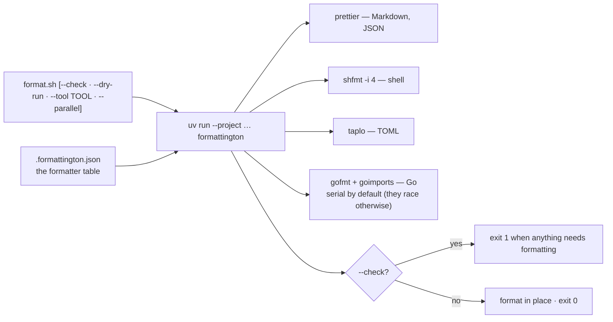

# Formatting (`scripts/format.sh`)



`scripts/format.sh` formats the sources of the repository with [formattington](https://github.com/fordaj/formattington), driven by the configuration in `.formattington.json`: `prettier` (Markdown, JSON), `shfmt -i 4` (shell), `taplo` (TOML), `gofmt` and `goimports` (Go).

## Usage

```bash
./scripts/format.sh                # format every source of the repository
./scripts/format.sh --check        # change nothing, exit 1 when a file needs formatting
./scripts/format.sh --dry-run      # print the differences, change nothing
./scripts/format.sh --tool shfmt   # run a single formatter
```

Options: `--check`, `--dry-run`, `--tool TOOL` (the arguments of the tool are read from `.formattington.json`, so a single tool runs exactly as in a full run), `--parallel` (concurrent; not safe while gofmt and goimports are both configured, so the default is `--series`), `--verbose`. Environment: `FORMATTINGTON_CONFIG_PATH`, `UV_PROJECT`.

`--check` and `--dry-run` are mutually exclusive.

## How it works

The tool itself is installed with [uv](https://docs.astral.sh/uv/) (`uv run --project <repo> formattington ...`); the locked versions come from `uv.lock`. The script adds `$(go env GOPATH)/bin` to `PATH` when it exists, because `goimports` is installed with `go install golang.org/x/tools/cmd/goimports@latest`. The formatters run **one after another** by default, because `gofmt` and `goimports` write to the same files and would race each other; `--parallel` opts out. Standard input is redirected from `/dev/null` so a formatter without matching files cannot block on a terminal.

Exit codes are formattington's: `0` success, `1` a file needs formatting (`--check`) or a formatter failed, `2` usage error, `127` a formatter is not installed.

Prerequisites: `uv`, and the formatters of the project (`prettier`/`shfmt` from npm and the Go toolchain, `taplo` from its releases, `gofmt` with Go, `goimports` as above). Sources [scripts/entry.sh.md](entry.sh.md) for the environment cascade.

## Related pages

- [scripts/test.sh.md](test.sh.md) — runs this as the formatting check
- [scripts/entry.sh.md](entry.sh.md) · [scripts/env.sh.md](env.sh.md)
- [README.md](../README.md) — the formatting section
