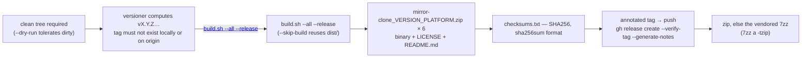

# The release pipeline (`scripts/release.sh`)

`scripts/release.sh` builds, packages, tags and publishes a release. The client the tool itself uses to read that release back is [release.go](../release.go.md); this page covers the pipeline that produces it.

## The release pipeline

Computes the version and tag with the pinned `tools/versioner/update.sh.md` (via [version.sh.md](version.sh.md) `--format version`/`--format tag` and [entry.sh.md](entry.sh.md)), cross compiles every platform with [build.sh](build.sh.md), and packages one archive per platform. Platforms come from the shared `SUPPORTED_PLATFORMS` of [entry.sh.md](entry.sh.md).

1. Requires a clean working tree (a dirty tree is only tolerated in `--dry-run`), `git`, `gh` authenticated, and a successful `git fetch origin --tags`.
2. The tag must match `vX.Y.Z...` and must not exist locally or on origin.
3. Builds with `scripts/build.sh --all --release` (unless `--skip-build`).
4. Packages `<RELEASE_DIR>/mirror-clone_<VERSION>_<platform>.zip` (`RELEASE_DIR` defaults to `temp/release`), each containing the binary, the `LICENSE` and the `README.md`. Archives are written with `zip` when available, otherwise with the bundled 7zz (`SEVENZZ_BIN`, from [env.sh.md](env.sh.md)) as `7zz a -tzip`.
5. Writes `checksums.txt` (SHA256, sha256sum format) into the release directory.
6. Creates the annotated tag, pushes it, and runs `gh release create <TAG> --verify-tag --generate-notes` with the archives attached.

`--dry-run` prints the plan and changes nothing; `--package-only` builds and packages without tagging, pushing or uploading; `--skip-build` reuses the binaries already in `dist/`. Prerequisites: `git`, `gh`, `zip` or the bundled 7zz, and a clean tree.

## Related pages

- [../release.go.md](../release.go.md) — the client that reads the published release
- [../update.go.md](../update.go.md) — the self update that consumes the release feed
- [build.sh.md](build.sh.md) — the cross compiler
- [version.sh.md](version.sh.md) · [env.sh.md](env.sh.md)
- `tools/versioner/update.sh.md`
- [../README.md](../README.md) — the releasing section
