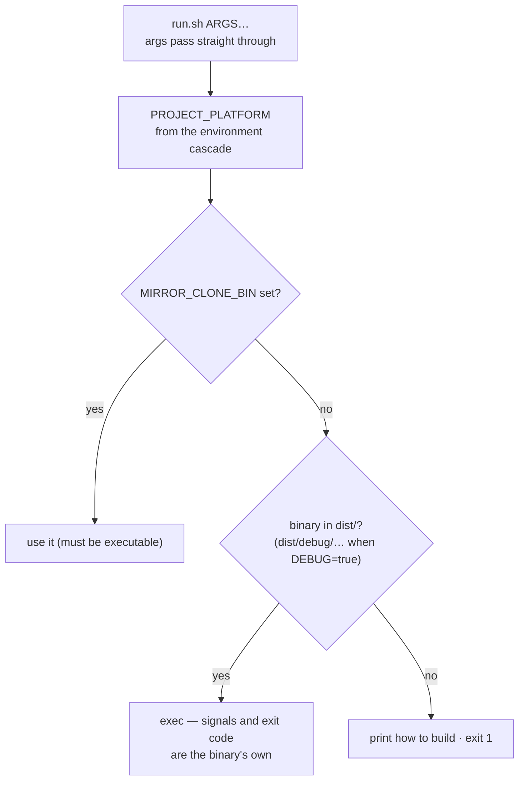

# Running the built binary (`scripts/run.sh`)



`scripts/run.sh` runs the mirror-clone binary that was built for the current machine. The platform is resolved with the environment cascade ([scripts/env.sh.md](env.sh.md)), the same way the bundled tools are resolved, and every argument is passed straight to the binary.

```bash
./scripts/run.sh --branch main git@github.com:fordaj/AirFrame.git
./scripts/run.sh --help
DEBUG=true ./scripts/run.sh --help        # runs the debug build
```

## Lookup order

1. `$MIRROR_CLONE_BIN` — when set, this binary is used (and must be executable).
2. `dist/<platform>/mirror-clone[.exe]` — release build; `dist/debug/<platform>/mirror-clone[.exe]` when `DEBUG=true`.

`<platform>` comes from `PROJECT_PLATFORM` in the environment cascade; Windows builds use `mirror-clone.exe`. When no binary is found the script prints how to build it (and points at the debug build when one exists) and exits `1`.

The lookup log line goes to **stderr**, so the output of the binary itself stays untouched, and the binary is `exec`'d directly — signals and the exit code are those of the binary.

Prerequisites: a build (see [scripts/build.sh.md](build.sh.md)) and the environment cascade ([scripts/env.sh.md](env.sh.md)).

## Related pages

- [scripts/build.sh.md](build.sh.md) — how the binary is produced
- [scripts/env.sh.md](env.sh.md) — where `PROJECT_PLATFORM` comes from
- [README.md](../README.md) — the running section
