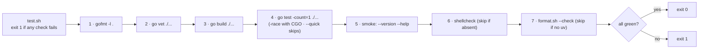

# The check suite (`scripts/test.sh`)

`scripts/test.sh` runs every check of the project and exits `1` when at least one of them failed. The checks, in order:

1. **gofmt** — `gofmt -l .` must report nothing (excluding `vendor/`).
2. **go vet** — `go vet ./...`.
3. **go build** — `go build -o <tmp>/ ./...`.
4. **go test** — `go test -count=1 ./...`; `-race` when CGO is enabled (skipped by `--quick`); `--coverage` adds `-coverprofile=coverage.out -covermode=atomic`; extra flags via `GO_TEST_FLAGS`.
5. **smoke test** — builds the binary in a temporary directory and runs `--version` and `--help`.
6. **shellcheck** — `shellcheck -x` on `scripts/build.sh`, `scripts/release.sh`, `scripts/test.sh`, `scripts/run.sh`, `scripts/format.sh` and `scripts/entry.sh`, `scripts/env.sh`, `scripts/version.sh` (skipped when shellcheck is not installed or `SKIP_SHELLCHECK=true`).
7. **formatting** — `./scripts/format.sh --check` (skipped when `uv` is not installed or `SKIP_FORMATTING=true`).

Usage: `./scripts/test.sh`, `./scripts/test.sh --coverage`, `./scripts/test.sh --quick`. The script requires the Go toolchain; it sources [scripts/entry.sh.md](entry.sh.md) for the environment cascade and `log()`.

Tests live next to the sources (`cli_test.go`, `install_test.go`, `mirror_test.go`, `update_test.go`, `url_test.go`) and use the standard `testing` package.

## Related pages

- [scripts/build.sh.md](build.sh.md) — the build the smoke test exercises
- [scripts/format.sh.md](format.sh.md) — the formatter behind check 7
- [scripts/entry.sh.md](entry.sh.md) · [scripts/env.sh.md](env.sh.md)
- [README.md](../README.md) — the testing section
