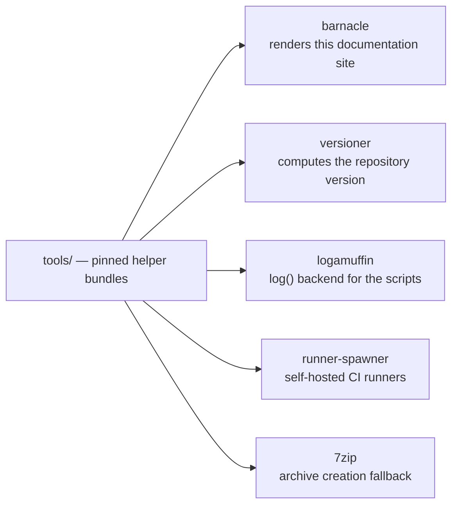

# Pinned helper tools (`tools/`)



`tools/` carries the repository's pinned helper binaries — build, release, logging, docs and archiving tooling — plus one `update.sh` per tool that refreshes them. They are not dependencies of the mirror-clone binary itself; they are the tools used to build, test, log and document this repository.

## Bundling convention

Every bundle follows the same layout:

```text
tools/<name>/
  update.sh           # refresh from the upstream GitHub release
  v<version>/<platform>/<binary>[.exe]
```

- Binaries are pinned by version directory; the pinned version is named by `*_VERSION_DIR` in [`scripts/.common.env`](../scripts/env.sh.md). `scripts/env.sh` resolves the **newest** `v*` directory present (`resolve_version_dir`), so the pin is a fallback, not a hard lock.
- `<platform>` is the hyphenated `<os>-<arch>` name (`linux-x86_64`, `macos-arm64`, `windows-x86_64`, …), matching `PROJECT_PLATFORM`. The 7zip bundle is the exception (see below).
- `update.sh` downloads the latest (or `--tag`ged) upstream release via `gh`, verifies checksums, stages into a temporary directory, swaps in atomically, and deletes superseded version folders only after the new one is staged — a failed refresh leaves the previous bundle intact. Each script has `--dry-run`, `--help`, and resolves its own directory (or sources `scripts/entry.sh`), so it can run from anywhere.
- Only the binary is kept, except [barnacle](barnacle/update.sh.md) and [versioner](versioner/update.sh.md), which also retain the upstream MIT `LICENSE`, and [7zip](7zip/update.sh.md), which keeps the full upstream payload (docs and `MANUAL/`).

## The bundles

| Tool | Used for | Docs |
| --- | --- | --- |
| [versioner](versioner/update.sh.md) | Computes the repository version (tag) for builds and releases | [update.sh](versioner/update.sh.md) |
| [logamuffin](logamuffin/update.sh.md) | Structured logging backend for `log()` in the scripts | [update.sh](logamuffin/update.sh.md) |
| [runner-spawner](runner-spawner/update.sh.md) | Manages self-hosted CI runners (not invoked by any script here; macOS + Windows only, Linux binaries still shipped) | [update.sh](runner-spawner/update.sh.md) |
| [barnacle](barnacle/update.sh.md) | Renders this documentation site | [update.sh](barnacle/update.sh.md) |
| [7zip](7zip/update.sh.md) | Vendored 7-Zip binaries (zip/7z archive creation) | [update.sh](7zip/update.sh.md) |

The pinned versions (in `scripts/.common.env`): versioner `v0.0.3.0.17`, logamuffin `v0.1.3.0.35`, runner-spawner `v0.0.1.2.16`, barnacle `v0.0.1.0.17`, 7zip `v26.06`.

`scripts/.common.env` and `scripts/.<platform>.env` select these via `*_VERSION_DIR`/`*_BIN`; see [env.sh.md](../scripts/env.sh.md). Archives are platform-native (`.tar.gz` on macOS/Linux, `.zip` on Windows) for barnacle, runner-spawner and versioner; logamuffin still ships legacy `.7z` archives; 7zip ships `.tar.xz` for macOS/Linux and a bare `7zr.exe` for Windows.

## 7zip

`tools/7zip/v26.06/` is a vendored copy of [7-Zip](https://www.7-zip.org/) 26.06, fetched from the [ip7z/7zip](https://github.com/ip7z/7zip) GitHub release by [7zip/update.sh](7zip/update.sh.md) and tracked in git (including the Windows binary, via a `!tools/**/*.exe` exception in `.gitignore`). Unlike the other bundles it keeps the **full upstream payload** (binaries plus `readme.txt`, `History.txt`, `License.txt` and `MANUAL/`) rather than just the executable, the platform naming is the vendored one (`linux-x64`, `mac-arm64`, `windows`, …, not the `<os>-<arch>` layout), and the release tag carries no leading `v` while the bundle directory is `v<tag>`.

Layout: `v26.06/{linux-arm,linux-arm64,linux-x64,linux-x86,mac-arm64,mac-x64}/7zz` (+ `7zzs` except macOS) and `v26.06/windows/7zr.exe`. `scripts/.common.env` pins `SEVENZIP_VERSION_DIR=tools/7zip/v26.06`; each platform env file points `SEVENZZ_BIN` at the matching binary (`7zz` for macOS/Linux, `7zr.exe` for Windows, 7z-format only), or `env.sh` falls back to `7zz`/`7z` on `PATH` when the bundled one is missing (see [env.sh.md](../scripts/env.sh.md)).

Consumers:

- [`release.sh`](../scripts/release.sh.md) uses `SEVENZZ_BIN` as a `zip` replacement (`7zz a -tzip`) to create the release archives when `zip` is not installed.
- The `.7z` bundle updater ([logamuffin](logamuffin/update.sh.md)) needs a `7z`/`7zz` on `PATH` — the vendored binaries qualify. (The versioner updater used to need the same, but consumes the platform-native archives since v0.0.3.0.17.)

To refresh 7zip, run `tools/7zip/update.sh` (see its [page](7zip/update.sh.md) for the asset mapping and the digest verification). The `SEVENZIP_VERSION_DIR` pin and the per-platform paths need no edit as long as the layout stays the same — `resolve_version_dir` prefers the newest `tools/7zip/v*` directory.

## Refreshing a pinned tool

```bash
tools/barnacle/update.sh            # download the latest release, verify, swap
tools/barnacle/update.sh --dry-run  # show what would change
```

(Same flags for `versioner`, `logamuffin`, `runner-spawner`, `7zip`.) Refreshes are checksum-verified; the barnacle, runner-spawner and versioner updaters verify only the archives downloaded for the run and refuse to install when an entry for a downloaded asset is missing; the logamuffin updater verifies `checksums.txt` wholesale and only warns when it is absent. The 7zip updater verifies every downloaded asset against the per-asset SHA-256 digest GitHub publishes (there is no checksums file upstream) and refuses to install when an asset has no digest entry. Runner-spawner additionally refuses to install at all without a checksums file — it never installs unverified binaries — while barnacle and versioner only warn. The runner-spawner bundle was most recently updated to **v0.0.1.2.16** and the versioner bundle to **v0.0.3.0.17**.

## Related pages

- [scripts/env.sh.md](../scripts/env.sh.md) — how the cascade selects these binaries
- [scripts/docs.sh.md](../scripts/docs.sh.md) — barnacle in action
- [../release.sh.md](../scripts/release.sh.md) — the release pipeline (consumes versioner and 7zip)
- [../README.md](../README.md)
