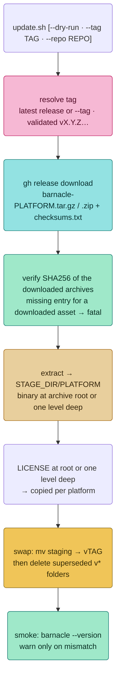

# The barnacle bundle (`tools/barnacle/`)



[Barnacle](https://github.com/fordaj/barnacle) is a documentation-site generator: it renders the `.md` and `.mmd` files scattered through a repository into a static, navigable HTML site. mirror-clone uses it to render *this* documentation; the site you may be reading was built by it.

## Layout

```text
tools/barnacle/
  update.sh                     # refresh from fordaj/barnacle releases
  v0.0.2.1.25/
    macos-arm64/barnacle
    macos-arm64/LICENSE           # upstream MIT text, copied per platform
    macos-x86_64/barnacle
    macos-x86_64/LICENSE
    linux-arm64/barnacle
    linux-arm64/LICENSE
    linux-x86_64/barnacle
    linux-x86_64/LICENSE
    windows-arm64/barnacle.exe
    windows-arm64/LICENSE
    windows-x86_64/barnacle.exe
    windows-x86_64/LICENSE
```

## `update.sh` in detail

Adapted to barnacle's release format: assets are `barnacle-<platform>.tar.gz` (macOS/Linux) and `barnacle-<platform>.zip` (Windows); legacy `.7z` assets are still accepted as a fallback. The script:

1. Resolves the tag (latest release, or `--tag vX.Y.Z...`), validating the tag shape (`vX.Y.Z...`).
2. Downloads via `gh` (only the platform archives and the checksums file), then verifies every downloaded archive against `SHA256SUMS.txt` or `checksums.txt` (`shasum -a 256 -c` or `sha256sum -c`, verifying only the archives downloaded for this run). A mismatch, or a missing entry for a downloaded asset, is fatal; a release without checksums only warns.
3. Extracts each archive (`tar` for `.tar.gz`; `unzip` for `.zip`; `7zz`/`7z` for `.7z`), finds the binary at the archive root or one directory down (`barnacle`/`barnacle.exe`), copies it into `v<tag>/<platform>/`, makes it executable and rejects empty files. A `LICENSE` at the archive root or one level deep (the `barnacle-<platform>/` layout) is copied into the platform directory alongside the binary.
4. Swaps in the new version directory and deletes superseded `v*` folders only after the new one is fully staged — a failed download leaves the previous bundle intact.
5. Smoke-tests the host binary (`barnacle --version`); a version that does not contain the tag only warns.

Licenses: MIT — see `v0.0.2.1.25/<platform>/LICENSE`. Environment overrides: `BARNACLE_REPO`, `BARNACLE_TAG`. `--dry-run` lists assets and planned removals without touching anything; `--help` shows usage. Prerequisites: `gh` and `tar` (plus `unzip`, or `7z`/`7zz` for legacy `.7z` assets). `update.sh` resolves its own directory, so it can run from anywhere.

## How the repository uses it

[scripts/docs.sh](../../scripts/docs.sh.md) resolves `BARNACLE_BIN` through the [env cascade](../../scripts/env.sh.md) and generates `./site/` from the repo root; the output is git-ignored.

## Related pages

- [../README.md](../README.md) — the bundle index
- [../../scripts/README.md](../../scripts/README.md) — the scripts that consume the bundle
