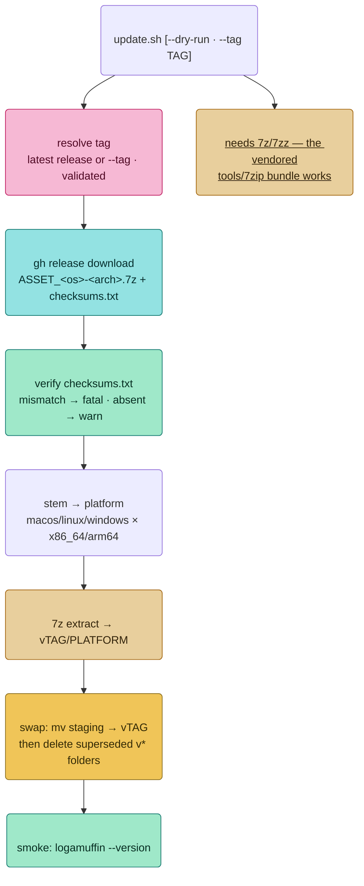

# The logamuffin bundle (`tools/logamuffin/`)



[logamuffin](https://github.com/fordaj/logamuffin) is the structured logging backend used by the repository's scripts: [scripts/entry.sh](../../scripts/entry.sh.md) forwards `log LEVEL MESSAGE...` to `LOGAMUFFIN_BIN`, passing the call site in `LOG_SOURCE`.

## Layout

```text
tools/logamuffin/
  update.sh                     # refresh from fordaj/logamuffin releases
  v0.1.3.0.35/
    macos-arm64/logamuffin
    macos-x86_64/logamuffin
    linux-arm64/logamuffin
    linux-x86_64/logamuffin
    windows-arm64/logamuffin.exe
    windows-x86_64/logamuffin.exe
```

## `update.sh` in detail

The `.7z` bundle family: assets are `*_<os>-<arch>.7z` archives plus `checksums.txt`, so a `7z`/`7zz` binary is required for a real update (the vendored one under `tools/7zip/` works). The script:

1. Resolves the tag (latest release, or `--tag vX.Y.Z...`), validating the tag shape.
2. Downloads via `gh`, then verifies the archives against `checksums.txt` (`shasum -a 256 -c` or `sha256sum -c`). A mismatch is fatal; a missing `checksums.txt` only warns.
3. Maps each asset stem to a platform exactly as the versioner bundle does, extracts with `$SEVENZIP`, copies the binary (`logamuffin`/`logamuffin.exe` at the archive root) into `v<tag>/<platform>/`, makes it executable and rejects empty files.
4. Swaps in the new version directory and deletes superseded `v*` folders only after the new one is fully staged — a failed download leaves the previous bundle intact.
5. Smoke-tests the host binary (`logamuffin --version`); a version that contains neither the tag nor `${TAG#v}` only warns.

Environment overrides: `LOGAMUFFIN_REPO`, `LOGAMUFFIN_TAG`. `--dry-run` lists assets and planned removals without touching anything; `--help` shows usage. Prerequisites: `gh`, and `7z`/`7zz` for the real update. `update.sh` sources [scripts/entry.sh](../../scripts/entry.sh.md) and can run from anywhere.

## Related pages

- [../README.md](../README.md) — the bundle index
- [../../scripts/entry.sh.md](../../scripts/entry.sh.md) — the `log()` function that calls the binary
- [../../scripts/env.sh.md](../../scripts/env.sh.md) — how `LOGAMUFFIN_BIN` is resolved
