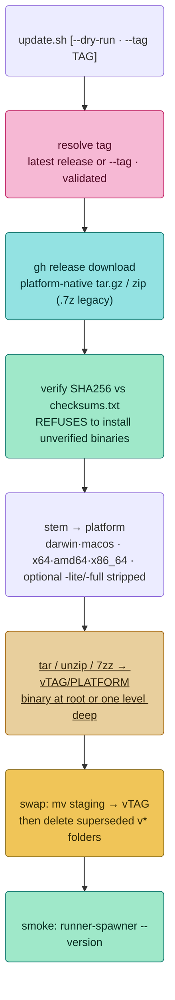

# The runner-spawner bundle (`tools/runner-spawner/`)



[runner-spawner](https://github.com/fordaj/runner-spawner) manages self-hosted CI runners. No script in this repository invokes it; it is pinned and resolved like the other bundles so the tooling is there when CI work needs it, and so the bundle layout stays uniform. It reports unsupported on Linux (macOS + Windows only; the Linux binaries are still shipped), and `windows-arm64`/`windows-x86_64` are bundled.

**The bundle was updated to runner-spawner v0.0.1.2.16** (see the git history: "Update runner-spawner to latest version" and "Bump runner-spawner pin to v0.0.1.2.16"). `scripts/.common.env` pins `RUNNER_SPAWNER_VERSION_DIR=tools/runner-spawner/v0.0.1.2.16`; [scripts/env.sh.md](../../scripts/env.sh.md) prefers any newer `v*` directory that shows up in the bundle.

## Layout

```text
tools/runner-spawner/
  update.sh                     # refresh from fordaj/runner-spawner releases
  v0.0.1.2.16/
    macos-arm64/runner-spawner
    macos-x86_64/runner-spawner
    linux-arm64/runner-spawner
    linux-x86_64/runner-spawner
    windows-arm64/runner-spawner.exe
    windows-x86_64/runner-spawner.exe
```

## `update.sh` in detail

The platform-native archive family (like barnacle and versioner, unlike logamuffin): assets are `*.tar.gz` (macOS/Linux), `*.zip` (Windows) or legacy `.7z`, carrying the tag and the `<os>-<arch>` pair separated by either `_` or `-`. The script:

1. Resolves the tag (latest release, or `--tag vX.Y.Z...`), validating the tag shape.
2. Downloads via `gh`, then verifies every downloaded archive against `checksums.txt` or `SHA256SUMS.txt` (`shasum -a 256 -c` or `sha256sum -c`, verifying only the archives downloaded for this run). A mismatch, or a missing entry for a downloaded asset, is fatal — **this updater refuses to install unverified binaries**.
3. Maps each asset stem to a platform with a regex that normalizes separators, `x64`/`amd64` → `x86_64`, `darwin` → `macos`, and strips an optional `-lite`/`-full` variant suffix; extracts with `tar`/`unzip`/`7zz` (legacy `.7z`), finds the binary at the archive root or one directory down (`runner-spawner`/`runner-spawner.exe`), copies it into `v<tag>/<platform>/`, makes it executable and rejects empty files.
4. Swaps in the new version directory and deletes superseded `v*` folders only after the new one is fully staged — a failed download leaves the previous bundle intact.
5. Smoke-tests the host binary (`runner-spawner --version`); a version mismatch only warns.

Environment overrides: `RUNNER_SPAWNER_TOOL_REPO`, `RUNNER_SPAWNER_TAG`. `--dry-run` lists assets and planned removals without touching anything; `--help` shows usage. Prerequisites: `gh` and `tar` (plus `unzip`, or `7z`/`7zz` for legacy `.7z` assets). `update.sh` resolves its own directory, sources [scripts/entry.sh](../../scripts/entry.sh.md) and can run from anywhere.

## Related pages

- [../README.md](../README.md) — the bundle index
- [../../scripts/env.sh.md](../../scripts/env.sh.md) — how `RUNNER_SPAWNER_BIN` is resolved
- [../barnacle/update.sh.md](../barnacle/update.sh.md) — the other native-archive bundle
