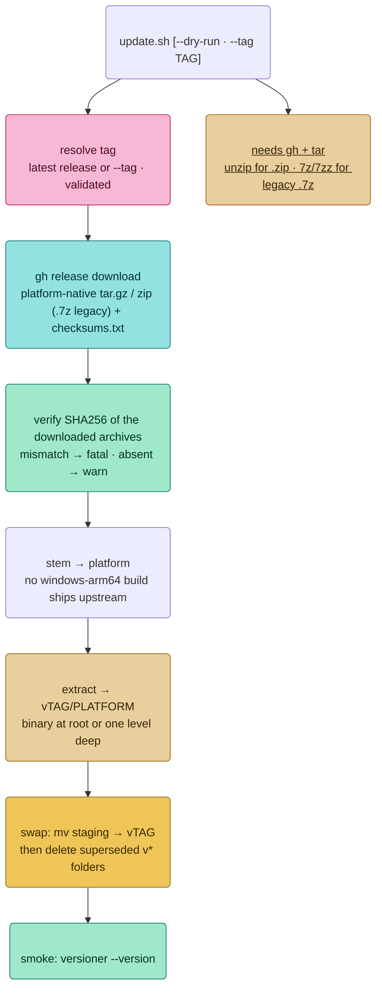

# The versioner bundle (`tools/versioner/`)



[Versioner](https://github.com/fordaj/Versioner) computes the repository version (the tag) from the git history and `.versioner.json` — the same computation the builds and the release use, so a local build and the published tag can never drift apart. It is consumed by [scripts/version.sh](../../scripts/version.sh.md), [build.sh](../../scripts/build.sh.md) and [release.sh](../../scripts/release.sh.md).

## Layout

```text
tools/versioner/
  update.sh                     # refresh from fordaj/Versioner releases
  v0.0.3.0.17/
    macos-arm64/versioner
    macos-x86_64/versioner
    linux-arm64/versioner
    linux-x86_64/versioner
    windows-x86_64/versioner.exe
    <platform>/LICENSE
```

There is no `windows-arm64` build (upstream ships windows-amd64 only); on windows-arm64 the cascade falls back to `versioner` on `PATH` (see [../../scripts/env.sh.md](../../scripts/env.sh.md)).

## `update.sh` in detail

The platform-native archive family (like barnacle and runner-spawner): assets are `*.tar.gz` (macOS/Linux), `*.zip` (Windows) or legacy `.7z`, plus a **cumulative** `checksums.txt`. The script:

1. Resolves the tag (latest release, or `--tag vX.Y.Z...`), validating the tag shape.
2. Downloads via `gh`, then verifies **only the archives downloaded for this run** against `checksums.txt` (`shasum -a 256 -c` or `sha256sum -c` on a filtered entry list) — upstream's checksums file is cumulative across releases, so verifying it wholesale would fail on entries for assets that were not downloaded. A mismatch or a missing entry for a downloaded asset is fatal; a missing `checksums.txt` only warns.
3. Maps each asset stem to a platform with a regex that normalizes separators, `x64`/`amd64` → `x86_64`, `darwin` → `macos` (`*_macos-x86_64`/`*_darwin-amd64` → `macos-x86_64`, `*_macos-arm64`/`*_darwin-arm64` → `macos-arm64`, `*_linux-x86_64`/`*_linux-amd64` → `linux-x86_64`, `*_linux-arm64` → `linux-arm64`, `*_windows-x86_64`/`*_windows-amd64` → `windows-x86_64`, `*_windows-arm64` → `windows-arm64`), extracts with `tar`/`unzip`/`7zz` (legacy `.7z`), finds the binary at the archive root or one directory down (`versioner`/`versioner.exe`), copies it into `v<tag>/<platform>/` together with the upstream MIT `LICENSE` when the archive ships one, makes it executable and rejects empty files.
4. Swaps in the new version directory and deletes superseded `v*` folders only after the new one is fully staged — a failed download leaves the previous bundle intact.
5. Smoke-tests the host binary (`versioner --version`); a version that does not contain the tag only warns.

Environment overrides: `VERSIONER_REPO`, `VERSIONER_TAG`. `--dry-run` lists assets and planned removals without touching anything; `--help` shows usage. Prerequisites: `gh`, `tar` and `unzip` (plus `7z`/`7zz` for legacy `.7z` assets — the vendored binaries under `tools/7zip/` qualify). `update.sh` sources [scripts/entry.sh](../../scripts/entry.sh.md) and can run from anywhere.

## Related pages

- [../README.md](../README.md) — the bundle index
- [../../scripts/version.sh.md](../../scripts/version.sh.md) — the consumer of the binary
- [../../build.sh.md](../../scripts/build.sh.md) · [../../release.sh.md](../../scripts/release.sh.md)
