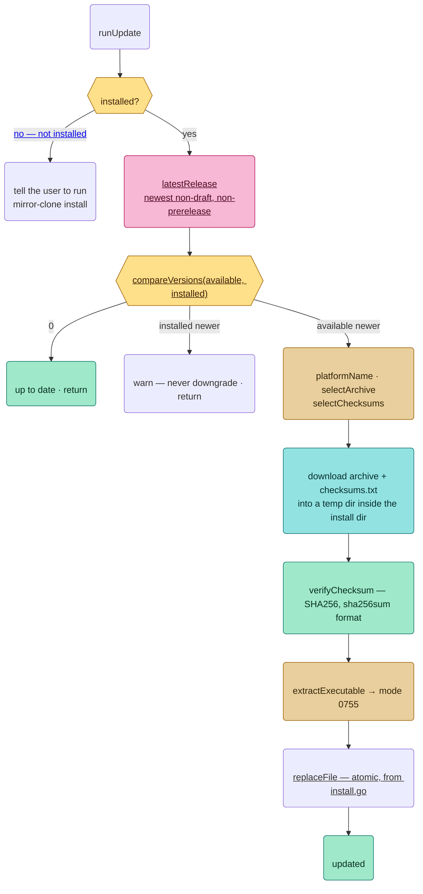

# Self update (`update.go`)

`update.go` implements `mirror-clone update`: replace the installed executable with the latest stable release of [fordaj/MirrorClone](https://github.com/fordaj/MirrorClone).

## The `updater`

`newUpdater(log, dir, name)` wires the release client (from [scripts/release.sh.md](scripts/release.sh.md)), an HTTP client with a `downloadTimeout` (30-minute) timeout for asset downloads, the install directory, and the version of the running executable (`version`, the build-time variable in [version.go.md](version.go.md)).

## `Run`

1. `releases.latestRelease(ctx)` — the newest published, non-draft, non-prerelease release.
2. `compareVersions(available, installed)`: equal → log "up to date" and return; the installed version is newer → warn and return (never downgraded).
3. `platformName(GOOS, GOARCH)` picks the archive platform (`linux`/`macos`/`windows` × `x86_64`/`arm64`); no match → error.
4. `selectArchive` picks `mirror-clone_<version>_<platform>.zip` (exact name preferred, otherwise any `mirror-clone_*_<platform>.zip`); `selectChecksums` picks `checksums.txt` (exact or suffix match).
5. The download happens in a temporary directory **inside the install directory**, so the new executable is moved into place instead of copied across devices. Both the archive and `checksums.txt` are downloaded, then `verifyChecksum` checks the SHA256 (sha256sum format, optional leading `*` on the file name) before anything is replaced.
6. `extractExecutable` finds the entry whose base name is the executable inside the zip, writes it with mode `0755`, and `replaceFile` ([install.go.md](install.go.md)) moves it over the target atomically.

If the download, verification, extraction or replacement fails, the error is returned and the installed executable is kept — a failed update never breaks the installation. `runUpdate` first checks that the tool is actually installed (otherwise it tells the user to run `mirror-clone install` first) and resolves the install directory the same way [install.go.md](install.go.md) does.

## Helpers

`download` (streaming through the shared `httpGet` helper from [release.go.md](release.go.md), with a status check), `verifyChecksum` / `parseChecksums` / `sha256File` (sha256sum format), `extractExecutable` / `writeArchiveEntry` (zip).

## Related pages

- [scripts/release.sh.md](scripts/release.sh.md) — the release client and archive selection
- [install.go.md](install.go.md) — `replaceFile`, install paths
- [version.go.md](version.go.md) — `compareVersions` and the build-time version
- [main.go.md](main.go.md) — command dispatch
