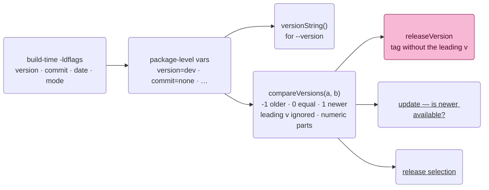

# Version handling (`version.go`)

`version.go` holds the build-time version of the binary and the version comparison used by the self update.

## Build information

`version` (`dev`), `commit` (`none`), `date` (`unknown`) and `mode` (`release`) are package-level variables that `scripts/build.sh` overrides with `-ldflags "-X main.version=... -X main.commit=... -X main.date=... -X main.mode=..."` ([scripts/build.sh.md](scripts/build.sh.md)). `versionString()` formats them for `--version`: `<version> (commit <commit>, built <date>, <mode>, <goos>/<goarch>)`.

## Comparison

`compareVersions(a, b)` returns `-1` when `a` is older, `1` when newer, `0` when equal. A leading `v` is ignored and the dot-separated parts are compared as numbers (`v0.0.1.0.10` > `0.0.1.0.9`); a part that is not a number ends the comparison, so a pre-release suffix never sorts above the release it belongs to. Missing parts count as `0`. `versionParts` does the splitting; `releaseVersion` returns the tag without the leading `v` for use in archive names.

`compareVersions` and `releaseVersion` are used by the update flow ([update.go.md](update.go.md)) and by the release selection in [scripts/release.sh.md](scripts/release.sh.md).

## Related pages

- [update.go.md](update.go.md) — the self update that compares versions
- [scripts/release.sh.md](scripts/release.sh.md) — release selection and archive naming
- [scripts/build.sh.md](scripts/build.sh.md) — where the ldflags live
